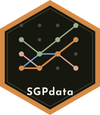

```{=html}
<section class="pkg-hero" aria-labelledby="pkg-name">
  
  <div>
    <p id="pkg-name" class="pkg-name" role="heading" aria-level="1">SGPdata</p>
    <p class="pkg-tagline">Exemplar Data Sets for Student Growth Percentiles (SGP) Analyses</p>
    <ul class="pill-links">
  <li><a href="https://github.com/CenterForAssessment/SGPdata">GitHub</a></li>
  <li><a href="https://CRAN.R-project.org/package=SGPdata">CRAN</a></li>
  <li><a href="articles/SGPdata.html">Get started</a></li>
  <li><a href="reference/index.html">Reference</a></li>
    </ul>
  </div>
</section>
```

## Overview

**SGPdata** holds the five exemplar data sets that the [SGP package](https://sgp.io) uses in its examples and tests. They show how to set up your own data for Student Growth Percentile (SGP) analyses.

| Data set | Format | Use |
|:--|:--|:--|
| `sgpData` | WIDE | The lower level functions `studentGrowthPercentiles()` and `studentGrowthProjections()` |
| `sgpData_LONG` | LONG | The higher level functions (`abcSGP()`, `prepareSGP()`, `analyzeSGP()`, ...) |
| `sgpData_LONG_COVID` | LONG | The same, with 2020 missing, to model the COVID-19 interruption |
| `sgptData_LONG` | LONG with a `DATE` | Time dependent analyses (SGPt) |
| `sgpData_INSTRUCTOR_NUMBER` | LONG lookup | Student-instructor lookup for teacher level summaries |

For operational analyses use LONG format data.

## Installation

From [CRAN](https://CRAN.R-project.org/package=SGPdata):

``` r
install.packages("SGPdata")
```

The development version from [GitHub](https://github.com/CenterForAssessment/SGPdata/):

``` r
# install.packages("pak")
pak::pak("CenterForAssessment/SGPdata")
```

## Usage

``` r
library(SGPdata)

head(sgpData)          # wide: ID, GRADE_2021 ..., SS_2021 ...
head(sgpData_LONG)     # long
table(sgpData_LONG_COVID$YEAR)   # no 2020
```

## The startup message

In an interactive session the package prints a short banner that compares the installed version with CRAN and GitHub. It waits at most two seconds for each request. Switch it off with

``` r
options(SGPdata.startup_message = FALSE)
```

or set the environment variable `SGPDATA_QUIET=true`. It never runs in scripts, `R CMD check` or on a server.

## For maintainers

`data-raw/README.md` explains how the data sets are guarded against accidental change and how to refresh the golden checks after a deliberate update.

## Resources

- [Website](https://centerforassessment.github.io/SGPdata/)
- [CRAN](https://CRAN.R-project.org/package=SGPdata)
- [SGP package](https://sgp.io)
- [Issues](https://github.com/CenterForAssessment/SGPdata/issues)

Maintained by [Damian Betebenner](https://github.com/dbetebenner) at the [Center for Assessment](https://www.nciea.org/).

