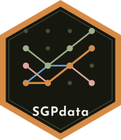

## Description

{style="float: right" width="120"}

Data sets used by the 'SGP' package as exemplars for users to conduct their own student growth percentiles (SGP) analyses: wide and long format data sets for fixed-time and time-dependent analyses, a data set with the 2020 COVID-19 interruption, and an instructor-student lookup table for teacher level summaries.

## See Also

Useful links:

-   <https://CenterForAssessment.github.io/SGPdata/>

-   <https://github.com/CenterForAssessment/SGPdata/>

-   <https://cran.r-project.org/package=SGPdata>

-   Report bugs at <https://github.com/CenterForAssessment/SGPdata/issues/>

## Author(s)

**Maintainer**: Damian W. Betebenner <dbetebenner@nciea.org>

Authors:

-   Damian W. Betebenner <dbetebenner@nciea.org>

-   Adam R. Van Iwaarden <avaniwaarden@nciea.com>

-   Ben Domingue <ben.domingue@gmail.com>

Other contributors:

-   Center for Assessment \[copyright holder\]

